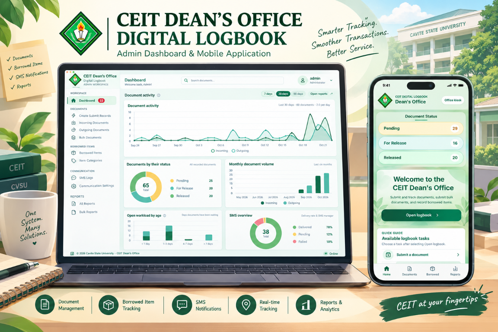

<div align="center">


<h1>CEIT Dean's Office Digital Logbook</h1>

<p><strong>A responsive document, bulk-paper, and inventory tracking workspace for the CVSU College of Engineering and Information Technology Dean's Office.</strong></p>

<p>Bring the admin dashboard, document workflows, QR status tracking, printable reports, and mobile logbook into one coordinated system.</p>

<p></p>
<p><sub>Project showcase: the admin dashboard and mobile logbook (illustrated with sample data).</sub></p>

<p>
<a href="https://www.php.net/"></a>
<a href="https://www.mysql.com/"></a>
<a href="https://react.dev/"></a>
<a href="https://vite.dev/"></a>
<a href="https://capacitorjs.com/"></a>
</p>
</div>

---

## Contents

- [Overview](#overview)
- [System flow and how it works](docs/SYSTEM-FLOW.md)
- [Highlights](#highlights)
- [Start here](#start-here)
- [Quick start](#quick-start)
- [What you can do](#what-you-can-do)
- [Technology](#technology)
- [Get started](#get-started)
- [Windows setup and computer-to-computer use](docs/WINDOWS-SETUP.md)
- [Mobile app](#mobile-app)
- [Project layout](#project-layout)
- [Patch history](#patch-history)
- [Security features](#security-features)
- [Security before deployment](#security-before-deployment)
- [Security guide](docs/SECURITY.md)
- [Troubleshooting](#troubleshooting)

## Overview

DIT Logbook provides one place to record office document activity, follow
incoming and outgoing submissions, organize bulk papers, and keep track of
borrowed items. The browser-based admin portal and mobile client use the same
PHP API and MySQL database.

> **New to the codebase?** Read [System Flow & How Everything Works](docs/SYSTEM-FLOW.md)
> first. It explains the request path, authentication, every document and bulk-paper
> lifecycle, QR tracking, the mobile API, SMS, reporting, and the workarounds behind
> each design decision.

### Start here

| Goal | Start with |
| --- | --- |
| Understand how the system works end to end | [System flow and how it works](docs/SYSTEM-FLOW.md) |
| Set up the admin portal on Windows | [Windows setup guide](docs/WINDOWS-SETUP.md) |
| Start the local/LAN server | Double-click [`start-office-server.bat`](start-office-server.bat) from the project folder inside XAMPP's `htdocs`. |
| Move the app and records to another computer | [Transfer instructions](docs/WINDOWS-SETUP.md#move-the-application-and-database) |
| Run or build the mobile client | [Mobile app instructions](#mobile-app) |
| Deploy outside a trusted local network | Read [Security before deployment](#security-before-deployment) first. |

## Quick start

The shortest path to a working admin portal on a Windows computer:

1. **Install XAMPP** (Apache, MySQL, PHP 8+) and copy this project folder into
   `C:\xampp\htdocs\`.
2. **Start Apache and MySQL** from the XAMPP Control Panel.
3. **Create the database:** open <http://localhost/phpmyadmin>, choose
   **Import**, and import [`database/schema.sql`](database/schema.sql).
4. **Start the portal:** double-click [`start-office-server.bat`](start-office-server.bat).
   Approve the Windows firewall prompt for **Private networks** only.
5. **Sign in** at `http://localhost/<your-folder-name>/login` with the seeded
   `admin` / `admin` account.
6. **Change the password immediately:** open **Administrator accounts →
   Change your password** and choose a unique password of at least 8
   characters.
7. **Create staff accounts** (optional) under **Administrator accounts** so
   each person signs in with their own credentials.
8. **Review Settings:** disable unauthenticated mobile kiosk access unless the
   network is fully trusted (see [Security before deployment](#security-before-deployment)).

Mobile app, phone QR scanning, and moving to another computer are covered in
the sections below and in the [Windows setup guide](docs/WINDOWS-SETUP.md).

## Highlights

- **One office workflow:** incoming and outgoing documents, bulk documents,
  borrowed items, SMS records, and reports share one PHP/MySQL database.
- **Traceable handoffs:** office-issued QR tokens let submitters check limited
  document or bulk submission status without exposing the admin workspace.
- **Shopee-style tracking:** one shared status set, an automatic tracking
  history timeline on the public tracker and bulk receipt, and an Incomplete
  flow with a requirements checklist and an "Action needed" banner.
- **Generated SMS:** messages are composed from the document's situation
  instead of fixed templates, with a staff preview before sending.
- **Purpose-built admin workspace:** separate priority indicators, direct
  record actions, responsive tables, top-of-screen submission alerts, and
  configurable themes and Compact Mode.
- **Ready-to-share reporting:** date-filtered All Reports, portrait print/PDF
  output with a university letterhead, search/status filters, and formatted
  Excel workbook export.
- **Web and Android clients:** a mobile-first React/Vite app can run in a
  browser or be packaged for Android with Capacitor.

## What you can do

| Area | Capabilities |
| --- | --- |
| **Dashboard** | Review activity summaries, daily counts, pending incoming work, document and borrowed item analytics, and recent records. The Overdue records panel counts only Incoming and Outgoing documents that stay open longer than the time limits set under Settings; click an Incoming or Outgoing tile to open a pop-out listing just those overdue documents, each with a **Review** button. Borrowed items are not counted as overdue. Small ⓘ guides explain the processing-time and SMS charts. |
| **Incoming documents** | Record the submitter's name and submitter type separately; optionally note the submitting department or office; issue office-verified QR tracking codes; search, filter by status, and sort records; and prepare documents for release. Only Pending documents are listed here, because a released document moves to Outgoing. Records are listed oldest first (first in, first out), with Priority documents on top. |
| **Outgoing documents** | Track outgoing records and release status, manage each document directly, and send client notifications. For Release documents are listed first, oldest first, so the longest-waiting document is handled first; a sort control switches to newest first. |
| **Bulk Documents** | Register bulk submissions, associate document-level records, separate Priority from Standard submissions, scan office QR codes, record received counts, and follow release status. |
| **Borrowed Items** | Manage item categories, borrowers, and return status. |
| **Records and reports** | Search logbook records; generate Incoming, Outgoing, Borrowed Items, SMS Logs, or All Reports; filter results by text/status; print a formal portrait document or export a formatted Excel workbook. |
| **SMS and notifications** | Configure SMS and email, send client updates, review delivery logs, and choose browser alerts and sounds. New-submission alerts appear in a neat top-of-screen notification. |
| **Admin Assistant** | Get privacy-friendly workflow guidance from a clickable side-peeking launcher and links to admin tools. Optional form assistance previews changes and requires approval before filling fields; it never submits forms. Toggle it in Settings. |
| **Mobile app** | Submit documents with a required submitter name and a clearly labeled Student/Faculty submitter type, receive a reference and status-tracking QR, scan office-issued codes, and access office logbook features. Admin settings control optional form fields and public kiosk access. |
| **Statuses and history** | Change status from the clickable badge on Incoming, Outgoing, and Bulk pages. Every change is recorded automatically and shown as a timeline on the tracker. Marking a document **Incomplete** opens a requirements checklist and an optional generated SMS preview; the mobile app simplifies document statuses to Pending, For Release, and Released. |
| **Document tracker** | A separate, mobile-friendly public page shows only the status tied to an office-issued, unguessable QR token. Its API URL respects the project's folder path, including when installed under XAMPP `htdocs`. |

### Incoming submission fields

- **Name of person submitting** identifies the individual and is required in
  both mobile and admin incoming-document forms.
- **Submitter type** records whether the person is a Student, Faculty member,
  or Other. It is distinct from their name and replaces the ambiguous
  **From** label in the mobile form and shared form-label settings.
- The mobile **From / submitter type** field can be shown or hidden with the
  **Show and require the submitter type** switch in Admin Settings. When
  hidden, mobile submissions store the type as **Other**.
- Incoming submission forms in both the admin portal and mobile app do not
  request a recipient.
- **Submitting department or office** is an optional admin-only field for
  documents delivered on behalf of a department. Leave it blank for an
  individual submission; it is not a replacement for the submitter's name.

### Reports, tables, and document actions

- **All Reports** combines incoming and outgoing documents, borrowed items,
  and SMS logs for the selected dates. Its formal print layout uses portrait
  pages, a centered university heading, fixed-width columns, and wrapped
  headings and category names. Very long print details are shortened to keep
  rows readable; the Excel workbook retains the complete report content.
- Search and status filters work with the report preview and update its
  visible record count. The Excel export includes clear headings, the selected
  reporting period, generation time, and readable column widths.
- Incoming, Outgoing, Quick Submit, Borrowed Items, SMS Logs, Records, and
  other admin tables share a consistent green-header and alternating-row
  treatment. Tables adapt to touch-friendly cards on narrow screens.
- Incoming and Outgoing keep priority separate from row actions. Quick Submit
  includes a **Manage** link to the specific record in the appropriate
  Incoming or Outgoing list.
- Long admin tables are split into pages of 10 rows with Previous/Next and
  numbered page controls, and reports are split into pages of 25 rows. Report
  printing and Excel export always include every matching record.
- On wide screens the row actions stay pinned to the right edge of a table and
  show their names in a tooltip. On narrow screens each record becomes a card
  with full-width action buttons. Tracking links appear as an
  **Open tracking page** button instead of a raw URL, and long text is shortened
  to two lines with the full text on hover.
- The dashboard **Review** buttons open the exact Incoming, Outgoing, or
  Borrowed record in question, with a banner naming it and a **Show all**
  button.
- Printed reports use consistent page margins, repeat the table heading on
  every page, and include an SMS status guide (Delivered, Pending, Failed).
- Bulk-paper history keeps priority, status, paper intake, and row actions
  distinct. Receipt confirmation is recorded separately from QR scanning;
  mismatched paper counts require a note.

## Admin workspace options

- **Admin appearances** are available in **Settings** and apply across the
  portal, including Compact Mode. **Classic** remains the default;
  **Civic Canvas** offers an editorial green-and-warm-canvas design, while
  **Prism Glass** uses translucent frosted panels with CvSU-inspired green and
  soft sage accents. Appearance choices are stored in the current browser.
- **Dashboard overview** in the alternate appearances replaces the greeting
  with office activity, today's incoming and outgoing counts, pending incoming
  work, and shortcuts for common tasks.
- **Sign-in page** uses a responsive campus-branded visual design while
  retaining the existing authentication and credential handling.
- **Compact Mode** turns the admin portal into a mobile-style workspace, even
  on desktop. It hides the sidebar, adds a bottom navigation dock and More
  sheet, and presents records in touch-friendly cards. Its mint-and-cream
  palette uses CVSU green for active navigation and primary actions.
- **Compact Mode controls** are available in both the administrator dropdown
  and **Settings**. The larger switch shows a clear On/Off state and updates
  immediately when changed.
- **Compact Mode quick actions** use a balanced two-column layout. Incoming
  document forms stay within a readable dialog instead of stretching across
  the full screen.
- **QR scanning from the dashboard** opens the camera tool in a focused,
  responsive dialog. The embedded scanner no longer inherits the Compact
  Mode navigation dock, leaving the camera preview and scan controls usable.
  Camera access on a phone requires opening the app through HTTPS with a
  certificate trusted by that phone. A computer's `localhost` address does
  not carry over to a phone; if HTTPS is unavailable, upload a QR image in the
  scanner instead.
- **Admin Assistant** stays tucked at the screen edge as a clickable handle.
  Hover or focus to reveal it, then click to open the guide. Disable or restore
  it from **Settings**. Form assistance only fills values after an approval
  preview; the assistant never submits a form.
- **Browser preferences** include activity polling, sound and optional
  privacy-conscious desktop alerts, top-of-screen submission notifications,
  the assistant, and Compact Mode. These preferences are saved in the current
  browser and synchronized between open admin tabs.
- **Server recovery** provides a status screen and retry guidance when the
  office server or database disconnects; the admin interface also shows live
  server and network status.

## Technology

| Component | Technology |
| --- | --- |
| Admin portal and API | PHP, MySQLi |
| Database | MySQL / MariaDB |
| Mobile web app | React, Vite |
| Android app | Capacitor |
| Local web server | Apache with `mod_rewrite` |

## Get started

### Requirements

- Windows with [XAMPP](https://www.apachefriends.org/) (Apache, MySQL, PHP)
- PHP 8+ with the **MySQLi** and **cURL** extensions enabled
- Apache `mod_rewrite` enabled
- [Node.js and npm](https://nodejs.org/) for mobile development
- Android Studio, Android SDK, and a configured device/emulator to run the
  Android app

For the administrator portal, XAMPP and a database are required. Node.js is
only needed for mobile development/builds; Android Studio and the Android SDK
are only needed to build or run the native Android project.

### 1. Set up the web app

1. Put the project folder in the XAMPP web root:
   `C:\xampp\htdocs\<any-folder-name>`. The folder can be renamed or copied
   without editing the app's routing configuration.
2. On first setup, start **Apache** and **MySQL** in the XAMPP Control Panel,
   open phpMyAdmin, and import [`database/schema.sql`](database/schema.sql).
   It creates the `dit_logbook` database and the tables used by the application.
3. Review the connection values in [`db.php`](db.php). The local defaults are:

   | Setting | Default |
   | --- | --- |
   | Host | `localhost` |
   | Database | `dit_logbook` |
   | Username | `root` |
   | Password | *(empty)* |

4. Double-click [`start-office-server.bat`](start-office-server.bat). It starts
   XAMPP Apache and MySQL if needed, finds the current project folder and
   network address, and opens the admin portal. On first run, approve the
   Windows prompt to add a firewall rule for Apache on port 80 **only on
   Private networks**. This avoids manually creating the rule in Windows
   Firewall.

   The launcher displays both the local address and addresses for other
   computers on the same trusted Wi-Fi/network. Keep the host computer and
   XAMPP running while others use the site. If Windows classifies a trusted
   office/home network as Public, change that network to Private in Windows
   Settings; the launcher deliberately does not allow connections on Public
   networks.

For step-by-step first-time setup, firewall behavior, and transfer details,
see [Windows Setup and Computer-to-Computer Use](docs/WINDOWS-SETUP.md).

#### Moving the app and its records to another computer

Copy the whole project folder into that computer's XAMPP `htdocs` directory.
To move existing records, export the `dit_logbook` database as an SQL file from
phpMyAdmin on the old computer, then import that export on the new computer.
[`database/schema.sql`](database/schema.sql) initializes the schema for a
fresh install; it does not contain your live records. Check the new computer's
database username and password in [`db.php`](db.php), then run
[`start-office-server.bat`](start-office-server.bat). Do not copy a live MySQL
data directory while its server is running.

#### Optional sample data

[`database/dummy_data.sql`](database/dummy_data.sql) holds sample records for
trying the system, and import it after `schema.sql`. It follows the app's
rules: Incoming holds only Pending documents, Outgoing holds For Release and
Released documents, some records are overdue, SMS logs belong to outgoing
documents, and bulk submissions are recorded only as batches. To change the
amounts, edit the counts at the top of
[`database/generate_dummy_data.js`](database/generate_dummy_data.js) and run
`node database/generate_dummy_data.js`. Remove the leading `-- ` from the
TRUNCATE line at the top of the SQL file first if you want to replace earlier
sample data.
This launcher is for the host computer and other devices on the same trusted
Private network; it does not make the site available over mobile data or the
public internet. Phone camera scanning requires trusted HTTPS, which needs a
certificate configured for the new host. Until HTTPS is set up, use the QR
image-upload option on the scanner.

The extension-free routes depend on Apache URL rewriting. If you see a 404
when opening a page, confirm that `mod_rewrite` is enabled and that Apache
allows the project’s `.htaccess` rules.

### 2. Sign in for the first time

The schema seeds an initial admin account for local setup:

| Username | Initial password |
| --- | --- |
| `admin` | `admin` |

The application upgrades the seeded plaintext password to a password hash
when it is first used. Change the default password immediately after signing
in, and never reuse it on a deployed system. On a fresh installation, use
**Administrator accounts → Change your password**. For an existing database,
back it up, run
[`database/promote_admin_to_super_admin.sql`](database/promote_admin_to_super_admin.sql)
once, then sign in as `admin` and change its password from
**Administrator accounts**.

The login page has a **Show / Hide password** button (the eye icon inside the
password field) so you can check what you typed before signing in. It only
changes how the field is displayed in your browser; the password is never
stored or sent until you press **Sign In**.

#### Administrator accounts and password recovery

| Role | What it can do |
| --- | --- |
| **Super Admin** | Everything a standard admin can do, plus open **Administrator accounts** to create, reset, and remove standard administrator accounts and change its own password. |
| **Admin** | Use the logbook (documents, bulk documents, borrowed items, reports, settings). Cannot manage accounts. |

**Create a staff account:** sign in as Super Admin → **Administrator accounts**
→ enter a username (3–100 letters, numbers, `.`, `_`, or `-`) and a password
of at least 8 characters, confirmed twice → **Create account**. Share the initial password through a
secure channel, such as in person.

**A standard admin forgot their password (self-service by SMS):**

1. On the login page they choose **Forgot your password?**, enter their
   username, and choose **Send recovery code**.
2. A 6-digit code is texted to the account's **recovery phone**. It expires
   after 10 minutes, works once, and is locked after 5 wrong tries.
3. They enter the code and a new password (8+ characters, typed twice). The
   account is signed out everywhere, including the mobile app, and a notice
   SMS confirms the change.

SMS recovery needs two things: SMS is enabled with a PhilSMS token in
**Communication Settings**, and the account has a recovery phone. A Super Admin
adds or changes it under **Administrator accounts → Recovery phone** (or while
creating the account). The page gives the same reply for unknown accounts,
accounts without a phone and valid accounts, requests are limited (one code a
minute, 3 an hour per username, 10 an hour per device), and codes never
appear in the SMS logs.

**No recovery phone, or SMS is unavailable:** ask a Super Admin to reset it.
They open **Administrator accounts**, select **Reset password**, enter a new
temporary password (8+ characters) twice, and choose **Save password**, then
share it securely. Resetting a password signs that account out of any
existing sessions.

**The Super Admin forgot their password:** a Super Admin can also use SMS
recovery once they have saved their own recovery phone under **Administrator
accounts → Your recovery phone** (this needs their current password). If that
is not set up, the server owner runs
`php tools/reset_admin_password.php <username>` from a command prompt on the
server (it works from the command line only), or recovers it through the
database after taking a backup. Store the Super Admin credentials in an
approved password manager or sealed offline record so this is rarely needed.

Password reset by email is intentionally not provided: admin accounts have no
recovery email address and the system does not require SMTP to be configured.

### 3. Configure workspace and communication settings (optional)

Open **Settings** from the administrator dropdown to personalize live activity
monitoring, alerts, and top-of-screen submission notifications for the current
browser, or turn on **Compact Mode** from the administrator dropdown.
Compact Mode switches the entire admin portal to a mobile-style layout with
four primary shortcuts and a bottom **More** menu for the remaining admin
sections, stacked content, card-based record lists, and a full-width
workspace—even on a desktop. Open **Communication Settings** to
configure system-wide SMS and email delivery. Mobile logbook access is managed
separately under **Admin Settings**. It is enabled by default only when no
access preference has been saved; turn it off for public or shared networks.
When enabled, anyone who can reach the server can view and change logbook
records through the mobile app. Activity
preferences are saved in the current browser; desktop alerts are optional
and require browser permission. Provider credentials belong in the application
settings or server environment—not in Git-tracked files or database exports.

Use the **Shared form labels** section in Admin Settings to rename sender,
recipient, document type, contact number, and remarks fields across supported
admin document/bulk-paper forms and the mobile app. The submitter-type switch
can hide that field in mobile document and Bulk Papers forms; hidden mobile
submissions use **Other** as the submitter type. Incoming document forms do
not request a recipient.
The **Mobile app appearance and experience** section lets administrators keep
the existing Classic kiosk UI as the default or switch to a translucent green
Glass theme, customize the kiosk header and welcome text, and enable or disable
successful-action and pull-to-refresh sounds. These settings are stored
server-side and apply to connected mobile clients. Glass adds frosted surfaces,
ambient highlights, staggered status and action-card entrances, responsive
button and form feedback, and animated dialogs. It honors the device's reduced-
motion preference.
The mobile **Submit Document**
form requires an 11-digit contact number; **Quick Submit** remains contact-free.
Mobile document-status lookup also includes bulk-paper batches assigned to the
entered contact number and displays each batch's current status and paper count.

### CMD log data maintenance

Start **CMD log** from the administrator menu to open the live command window.
In that window, `/clear` only clears the terminal display. Use
`/clear incoming`, `/clear outgoing`, `/clear batches`, `/clear borrowed`, or
`/clear sms` to request deletion of those records; `/clear all` clears all
listed log data. `/purge SCOPE` is an equivalent command. Each data-clear
request shows a prominent warning and affected-record counts, then requires
typing `YES` and an exact second phrase such as `DELETE INCOMING`. Use
`/cancel` at either prompt to abort.

The confirmation expires after two minutes. Empty affected tables have their
auto-increment reset to 1. Incoming and Outgoing share document references, so
clearing only one direction cannot reset the shared document counter while
records of the other direction remain; existing IDs are preserved. Clearing
`all` also resets the document, batch, batch-paper, borrowed-item, SMS, and
mobile submission audit counters. Admin accounts, settings, categories, and
API tokens are kept.

### Bulk-paper intake and receipts

1. In Admin Settings, choose the intake confirmation mode and QR payload:
   **Confirm with release** is the recommended mode; the receipt form appears
   when staff move a Pending batch to For Release, and both changes save
   together. Alternatively, staff can confirm receipt first from **Scan CEIT
   QR**, then move the batch to For Release.
2. The recommended localhost QR mode encodes only a local batch identifier.
   Staff scan it in Admin to look up the record; the scan itself never confirms
   receipt. The optional tracking-URL mode lets a device open the public tracker
   only when that device can reach the server. A localhost URL works only on the
   server device.
3. Staff enter the physical count. If it differs from the expected count, a
   note is required. The receipt stores the expected and received counts,
   confirmation time, and staff account. Scans are read-only and never overwrite
   an existing receipt.
4. Once intake is confirmed, the expected count cannot be edited and the batch
   or its papers cannot be deleted or removed, preserving the receipt record.
   Batch processing statuses remain visible separately from receipt confirmation.

### Scan QR codes from a phone on local XAMPP

Phone browsers require a trusted HTTPS origin before they will allow camera
access. The phone and host computer must be on the same trusted Wi-Fi/network,
and the HTTPS certificate must be trusted by the phone and valid for the
address used to open the app. Local IP addresses and certificates are specific
to a host computer; do not assume the address or development certificate from
another computer will work.

1. On the computer that hosts XAMPP, install Node.js and run `npm install` in
   `mobile-ui`. Start [`start-office-server.bat`](start-office-server.bat)
   and approve its Private-network firewall prompt.
   Alternatively, use **Admin Settings → Computer and network setup** to
   download and run the Windows helper; it provisions the certificate, starts
   XAMPP, configures Private-only firewall rules, and starts Vite when its
   dependencies are installed.
2. Start the mobile UI's HTTPS development server:

   ```powershell
   cd mobile-ui
   npm run dev:lan
   ```

   Its setup step creates a host-specific CA and an IP-matched certificate
   using XAMPP's OpenSSL when this computer has no usable certificate. The
   private keys stay in the computer's XAMPP certificate folders and are not
   shared through Git. Keep this command running.
3. On the computer, open **Admin Settings** and choose **Download
   certificate** under **Mobile camera certificate**. Transfer the downloaded
   public CA certificate to the phone using a trusted method.
4. Install that file on the phone as a **CA certificate**. On Android, use
   **Settings → Security → Encryption & credentials → Install a certificate
   → CA certificate** (menu names vary by device). On iPhone, install the
   downloaded profile in **Settings**, then enable full trust for it under
   **Settings → General → About → Certificate Trust Settings**.
5. Open the `https://<office-LAN-IP>:5173/` address printed by Vite on the
   phone, allow camera access, and use the QR scanner. Do not use the `http://`
   address or `localhost` on the phone. If a new CA is created later, install
   it on trusted phones again.

In **Admin Settings → Document status tracking**, set the **Tracker base URL**
to the phone-reachable Apache project URL, using HTTPS if Apache HTTPS is
configured, for example `http://192.168.1.20/CEIT-DEANS-DIGITAL-LOG-BOOK` on a
trusted local network. Do not use the Vite `:5173` address here: that is where
the mobile app runs; the QR status page and API are served by Apache. Leave
the setting blank only when the address used to reach the API is also the
correct address for the tracker. Update it if the project folder or future
domain changes. When scanned inside the mobile app on its HTTPS LAN address,
the app verifies each token with the office and opens the tracker through that
current server, so QR codes printed on a previous Wi-Fi network can still work.
Scanning an old QR directly with the phone's camera still uses its old address;
open the mobile app and use its QR scanner instead. QR tracking can be disabled
in the same Admin Settings section; disabling it blocks existing QR links as
well as new ones.

If the browser still reports an untrusted connection, confirm the CA is
installed and fully trusted, and that the certificate matches the address
being used. A public CA certificate is not a private key, but the matching
private key must never be shared or committed. This local development
certificate is not for a public or production server. See the
[Windows setup guide](docs/WINDOWS-SETUP.md#access-outside-the-local-network)
for the limits of the local setup. The Settings helper cannot change router
guest-network isolation or install the CA on a phone; those steps require
manual action on the trusted network and phone.

## Mobile app

The main mobile client is the React/Vite app in `mobile-ui/`, with Capacitor
providing its Android project. Use `npm run dev` for local browser work, or
`npm run dev:lan` to serve the development app over HTTPS to phones on the
same Private network. On Windows, `npm run dev:lan` creates a host-specific
certificate with XAMPP OpenSSL when needed. Install and trust the generated CA
on each phone. The CA and server private keys are machine-specific and must
not be copied through Git. The separate
`mobile-ui/expo-wrapper/` is an
optional Expo wrapper with its own dependencies; the steps below use the
primary Vite/Capacitor app.

### Run the web client locally

From the repository root, install dependencies and start the development
server:

```powershell
cd mobile-ui
npm install
npm run dev
```

Open the Vite URL shown in the terminal (usually
[http://localhost:5173](http://localhost:5173)). Keep Apache and MySQL running:
the Vite development server proxies `/api` requests to the PHP app under
the project's actual `htdocs` folder name.

To use the camera from a phone on the same trusted Wi-Fi/network, start the
server with `npm run dev:lan` instead. This serves Vite on HTTPS at port 5173;
run [`start-office-server.bat`](start-office-server.bat) first so its
Private-network firewall rule is present. Install and trust the local CA
certificate on the phone as described in [Scan QR codes from a phone on local
XAMPP](#scan-qr-codes-from-a-phone-on-local-xampp). Stop any existing Vite
server using port 5173 before starting the LAN server.

### Build the web client

```powershell
npm run build
```

The generated web app is written to `mobile-ui/dist`. This output is ignored by
Git and copied into the Android project by Capacitor when syncing/building.
You can recreate generated output with the build command; do not use generated
folders as the source when transferring the project.
For a browser deployment, publish the complete `dist` directory together:
`index.html` loads fingerprinted JavaScript and CSS files from `assets`, and
those files must come from the same build. The build output is not committed to
Git.

### Run on Android

With Android Studio, the Android SDK, and a device or emulator configured:

```powershell
npm run android
```

This script builds the web client and runs the Android app through Capacitor.

### Mobile API endpoint

The Android emulator's default API address uses `10.0.2.2` to reach the host
computer. The project folder is detected at build time. For a deployed API or
another server, set `VITE_API_ENDPOINT` at build time to the complete
`mobile-api.php` URL for that server. A built app cannot use the emulator's
`10.0.2.2` address to reach a production server.

## Project layout

```text
.
├── assets/
│   ├── audio/                        # Admin notification sounds
│   ├── css/                          # Admin stylesheets
│   ├── images/                       # Logos and other web images
│   └── js/                           # Browser-ready JavaScript bundles
├── database/
│   ├── schema.sql                    # Fresh-install schema and initial Super Admin seed
│   ├── dummy_data.sql                # Optional sample data (import after schema.sql)
│   ├── generate_dummy_data.js        # Regenerates dummy_data.sql
│   └── promote_admin_to_super_admin.sql # Existing-install role upgrade
├── docs/
│   ├── SYSTEM-FLOW.md                # End-to-end flow, workarounds, and internals
│   ├── SECURITY.md                   # Security model and deployment checklist
│   ├── WINDOWS-SETUP.md              # Windows setup and computer transfer
│   └── Patch V1.00.md                # Project patch history
├── tools/
│   ├── start-office-server.ps1       # XAMPP startup and network helper
│   ├── mobile_submission_console.php
│   └── start_mobile_submission_log.bat
├── start-office-server.bat           # Double-click Windows launcher
├── auth.php                          # Sessions, CSRF checks, and role enforcement
├── login.php / forgot_password.php   # Sign-in (with show/hide password) and SMS password recovery
├── users.php                         # Super Admin account management
├── sla_support.php                   # Overdue-record time limits
├── db.php                            # Database connection and query helpers
├── header.php / footer.php           # Shared admin layout
├── dashboard.php                     # Admin dashboard
├── incoming.php / outgoing.php       # Document workflows
├── batch_papers.php                  # Bulk paper registration
├── batch_tracker.php                 # Batch tracking
├── borrowed.php                      # Borrowed item management
├── records.php                       # Document search
├── reports.php                       # Reports
├── sms.php                           # SMS logs and operations
├── mobile-api.php                    # API for the mobile client
└── mobile-ui/
    ├── src/                         # React/Vite mobile client
    ├── android/                     # Capacitor Android project
    └── expo-wrapper/                # Optional Expo wrapper with separate dependencies
```

The root PHP files intentionally stay together because XAMPP serves this
directory as the application root and the clean routes, shared includes, and
form endpoints rely on those paths. Keep the whole project folder intact when
copying it to another XAMPP `htdocs` directory; the launcher detects its new
folder name. Do not copy `node_modules`, `dist`, or Android build/Gradle output
to move the project; those are generated or machine-specific and can be
recreated from the package manifests and source.

## Patch history

This log summarizes the project patches discussed and delivered in the
repository. Related chat iterations are grouped together; the commit hash
identifies the Git commit that contains the recorded changes.

| Patch | Commit | Summary |
| --- | --- | --- |
| **V1.00 — Source publication** | [`b82df29`](https://github.com/zakuweak0823/CEIT-DEANS-DIGITAL-LOG-BOOK/commit/b82df29) | Published the cleaned PHP/MySQL and React mobile/Capacitor source to the private GitHub repository. Added ignore rules for dependencies, generated output, and local data; excluded the database dump from the published snapshot. |
| **V1.01 — README and admin footer** | [`c8f3f47`](https://github.com/zakuweak0823/CEIT-DEANS-DIGITAL-LOG-BOOK/commit/c8f3f47) | Improved GitHub documentation with setup, features, mobile instructions, security guidance, badges, and troubleshooting. The admin footer was refined into a compact branded status bar showing network availability; footer work predating the clean repository snapshot is included in the published source. |
| **V1.02 — Server recovery** | [`bcd85eb`](https://github.com/zakuweak0823/CEIT-DEANS-DIGITAL-LOG-BOOK/commit/bcd85eb) | Added a styled database-disconnection page, retry guidance, JSON 503 responses, a health-check endpoint, and an authenticated admin outage/recovery notice. Distinguished an unreachable server from a browser offline state. |
| **V1.03 — Admin settings and mobile Compact Mode** | [`707b78e`](https://github.com/zakuweak0823/CEIT-DEANS-DIGITAL-LOG-BOOK/commit/707b78e) | Added a dedicated Settings page and route; browser preferences for activity polling, sound and desktop alerts, and the pending-documents bubble; and a persistent Compact Mode preference. Reworked Compact Mode as a phone-style workspace with card layouts, touch controls, and bottom-sheet dialogs. |
| **V1.04 — Compact navigation refinement** | Included in [`707b78e`](https://github.com/zakuweak0823/CEIT-DEANS-DIGITAL-LOG-BOOK/commit/707b78e) | Hid the sidebar in Compact Mode, lightened its theme, reduced the bottom dock to Dashboard, Pending inbox, New record, Records, and More, and moved other destinations into the More sheet. |
| **V1.05 — Patch history documentation** | [`cde0f54`](https://github.com/zakuweak0823/CEIT-DEANS-DIGITAL-LOG-BOOK/commit/cde0f54) | Added the versioned [`docs/Patch V1.00.md`](docs/Patch%20V1.00.md) history and linked it from the README. |
| **V1.06 — Admin Assistant** | Included in V1.07 below | Added a built-in, browser-side admin guide with suggested questions and links to common workflows. It does not call an external AI service, access record contents, or save chat history. |
| **V1.07 — Movable assistant and safe form help** | [`8fbda35`](https://github.com/zakuweak0823/CEIT-DEANS-DIGITAL-LOG-BOOK/commit/8fbda35) | Moved the assistant to a draggable side launcher with a smooth, on-demand panel and saved position. Added field-value previews that require approval before filling visible form fields; the assistant never submits forms. Compact Mode hides the CMD log control and stops an active log. |
| **V1.08 — Side-peeking assistant visibility setting** | Included in V1.09 below | Changed the assistant launcher to peek from the screen edge while keeping a clickable handle visible, revealing the full launcher on hover, focus, or drag. Added a Settings switch to hide or restore the assistant; the preference is saved per browser and synchronized across admin tabs. |
| **V1.09 — Compact Mode pastel palette and clearer switch** | [`f923104`](https://github.com/zakuweak0823/CEIT-DEANS-DIGITAL-LOG-BOOK/commit/f923104) | Replaced Compact Mode's gray-heavy surfaces with a soft mint-and-cream palette using CVSU green for emphasis. Improved the Compact Mode switch with a larger control and synchronized On/Off status badges in Settings and the admin dropdown. Also includes the V1.08 assistant visibility setting. |
| **V1.10 — Compact Mode quick actions and QR scanner** | [`5c1a9bc`](https://github.com/zakuweak0823/CEIT-DEANS-DIGITAL-LOG-BOOK/commit/5c1a9bc) | Constrained Compact Mode quick actions to a balanced two-column grid and kept dashboard action dialogs within readable widths. Isolated embedded scanner and batch tools from Compact Mode's full-screen shell and bottom dock so QR scanning controls remain visible and usable. |
| **V1.11 — Clear mobile camera security guidance** | [`a65ca54`](https://github.com/zakuweak0823/CEIT-DEANS-DIGITAL-LOG-BOOK/commit/a65ca54) | Detects insecure HTTP contexts before requesting camera access and explains that phone `localhost` points to the phone itself. Directs admins to use a trusted HTTPS address or the existing local QR-image upload fallback. |
| **V1.12 — Local HTTPS for phone QR scanning** | [`5453bb9`](https://github.com/zakuweak0823/CEIT-DEANS-DIGITAL-LOG-BOOK/commit/5453bb9) | Configured this XAMPP computer with a private development CA and an IP-matched Apache certificate, and documented how to install the CA on a phone and open the app over trusted HTTPS. The server and CA private keys remain outside the repository. |
| **V1.13 — Certificate download in Admin Settings** | [`28d774d`](https://github.com/zakuweak0823/CEIT-DEANS-DIGITAL-LOG-BOOK/commit/28d774d) | Added a download button to Admin Settings for the public local development CA certificate, with a clear unavailable notice if the certificate is not installed on the server. Updated the phone QR-scanning setup instructions to use the button. |
| **V1.14 — Clear submitter fields and reliable QR tracking** | [`e51c23c`](https://github.com/zakuweak0823/CEIT-DEANS-DIGITAL-LOG-BOOK/commit/e51c23c) | Replaced the ambiguous mobile “From” category label with “Submitter type”; made the admin submitting department/office field explicitly optional; fixed tracker API routing for installations in a named project folder; and documented the field meanings and phone tracker troubleshooting. |
| **V1.15 — Automatic LAN camera certificates** | This patch | `npm run dev:lan` now provisions a host-specific local CA and LAN-IP-matched TLS certificate with XAMPP OpenSSL when needed. Private keys remain outside the repository; the public CA can be downloaded from Admin Settings and trusted on phones. |
| **V1.18 — CMD log data maintenance** | This patch | Added CMD-only commands to clear Incoming, Outgoing, batch, borrowed-item, SMS, or all log data with an affected-record warning and two confirmations. Empty tables reset their auto-increment; the shared Incoming/Outgoing document sequence is preserved whenever records remain. |
| **V1.19 — Responsive tables, overdue tracking and sample data** | This patch | Added a Tracking QR column and professional wording across admin tables; responsive, aligned tables with icon-only pinned row actions and table pagination (10 rows, 25 in reports); Review links that open the exact record; an overdue pop-out on the dashboard that counts only documents; clearer report print margins and an SMS status guide; first-in-first-out ordering with a sort control for Incoming and Outgoing; and rule-based sample data with a generator script. |

Earlier chat iterations included repeated README and footer refinements,
pending-document bubble improvements and its hide/show setting, admin
notification/activity preferences, and several rounds of Compact Mode
redesign. Some iterations were consolidated into later commits rather than
saved as separate Git patches. See [Patch V1.00.md](docs/Patch%20V1.00.md) for the
expanded notes.

## Security features

A summary of the protections built into the system, grouped by type. See the
[Security guide](docs/SECURITY.md) for operational detail.

### Authentication and accounts

- **Password hashing:** passwords are stored with PHP `password_hash()` and
  checked with `password_verify()`; plaintext passwords are never stored for
  new or reset accounts. The seeded plaintext `admin` password is upgraded to
  a hash on first successful use.
- **Password strength:** new and reset administrator passwords must be at least
  8 characters.
- **Role-based access control:** Super Admin and Admin roles are re-verified
  against the database on every protected request. Account management is
  restricted to Super Admins.
- **Account safeguards:** a Super Admin account cannot be reset by another
  administrator or deleted through the portal, and an administrator cannot
  delete their own account.
- **Guarded self-service recovery:** an administrator with a recovery phone can
  reset a forgotten password with a one-time SMS code. Codes are hashed,
  expire in 10 minutes, work once and lock after 5 wrong tries; requests are
  throttled and the page never reveals whether an account exists. Without a
  recovery phone, resets require a Super Admin or trusted server access.

### Session security

- **Hardened cookies:** session cookies are `HttpOnly` (not readable by page
  scripts) and `SameSite=Lax`, and `Secure` when served over HTTPS.
- **Session fixation protection:** the session ID is regenerated on sign-in and
  after a password change.
- **Password-bound sessions:** each session is tied to the account's current
  password hash, so a password reset immediately signs out existing sessions.
- **Sign-out:** signing out destroys the server-side session.

### Request and input protection

- **CSRF protection:** every admin form submission (POST) must include a
  random per-session token, compared in constant time.
- **SQL injection prevention:** database values are bound through MySQLi
  prepared statements.
- **XSS prevention:** user-supplied values are HTML-escaped (UTF-8, quotes
  included) when displayed.
- **Server-side validation:** usernames, passwords, IDs, counts, lengths,
  phone numbers, and settings are validated on the server, not only in the
  browser.
- **Strict database errors:** the database layer reports errors as exceptions
  and logs them server-side instead of showing raw errors to users.

### Public tracking and mobile access

- **Unguessable tracking tokens:** QR tracking tokens are 64 hexadecimal
  characters generated from 32 cryptographically random bytes. The public
  tracker returns limited status fields only, never admin pages.
- **Tracking on/off switch:** QR document tracking can be disabled in Admin
  Settings.
- **Mobile kiosk switch:** unauthenticated mobile access is a setting that
  administrators can turn off.
- **Mobile API tokens:** bearer tokens are random, expire after 30 days, and
  only their SHA-256 digests are stored in the database.
- **CORS allow-list:** the mobile API sends cross-origin headers only for a
  small set of configured app origins.
- **Receipt integrity:** once bulk-paper intake is confirmed, the expected
  count cannot be edited and the batch or its papers cannot be deleted, and
  scans are read-only.

### Data, network, and operations

- **Destructive-action confirmations:** deleting records requires a
  confirmation dialog, and CMD-log data clearing requires typing `YES` plus an
  exact second phrase within two minutes.
- **No-cache responses:** live-activity, dashboard, and health endpoints send
  `Cache-Control: no-store` so sensitive data is not cached by the browser.
- **Restricted routing:** only explicitly listed pages are served through
  clean URLs, and database files are blocked from direct web access by
  [`database/.htaccess`](database/.htaccess).
- **Private-network firewall rule:** the Windows launcher opens Apache only on
  Private networks, never Public ones.
- **Secrets kept out of Git:** `.env` files, database exports, the local CA
  certificate, dependency folders, and build output are ignored by Git.
- **Privacy-conscious assistant:** the Admin Assistant runs in the browser,
  does not read record contents or call external services, and never submits
  forms.
- **Outage resilience:** database disconnections show a recovery page instead
  of exposing connection details.

### Known limitations

Be aware of what is **not** included, and mitigate it with your network and
hosting setup:

- No multi-factor authentication and no automated email password resets.
- No built-in login rate limiting or account lockout; restrict access to a
  trusted network.
- No application-set security headers such as CSP or HSTS; add them at the web
  server or reverse proxy when deploying beyond a local network.
- The mobile kiosk mode is intentionally unauthenticated when enabled.
- The seeded `admin` / `admin` login is public knowledge until changed.
- The local development HTTPS certificate is for trusted LAN use only.

## Security before deployment

- Read the detailed [Security guide](docs/SECURITY.md) before enabling
  computer-to-computer or mobile access.
- Read the [System flow guide](docs/SYSTEM-FLOW.md) before changing document or
  bulk-paper status transitions, the mobile API, or the QR tracker.
- Replace the seeded admin password immediately.
- Use a dedicated MySQL account with a strong password; do not deploy with the
  default XAMPP `root` account.
- Mobile logbook access without sign-in is a configurable kiosk feature. Turn
  it off on networks where every reachable device should not be allowed to
  submit or modify logbook data.
- Serve the application over HTTPS outside a local development environment.
- The local XAMPP CA described above is development-only; do not deploy it or
  copy its private key to another machine.
- Keep SMS/email credentials and private configuration out of source control.
- Do not commit database exports or production data. `db2.sql` and generated
  dependency/build folders are intentionally excluded from Git.
- Configure `VITE_API_ENDPOINT` for the deployed server before producing a
  production mobile build.

## Troubleshooting

| Problem | Things to check |
| --- | --- |
| Database connection error | Start MySQL and confirm the host, username, password, and database in `db.php`. |
| Clean page routes return 404 | Enable Apache `mod_rewrite` and allow `.htaccess` overrides for the project directory. |
| Another computer cannot open the site | Run `start-office-server.bat` on the host computer, approve its Private-network firewall prompt, and use the network URL it prints. Keep both computers on the same trusted network and leave Apache/MySQL running. |
| Mobile app cannot reach the API | Keep Apache/MySQL running and verify the Vite proxy or `VITE_API_ENDPOINT`. On Android emulators, use `10.0.2.2` rather than `localhost`. |
| `npm run dev:lan` says the LAN certificate files are missing | Run it as `npm run dev:lan` inside `mobile-ui`; its `predev:lan` setup creates a host-specific certificate with XAMPP OpenSSL. If setup reports OpenSSL or permission errors, verify XAMPP is above this project in `htdocs`, `apache\bin\openssl.exe` exists, and the account can write to Apache's `conf\ssl.crt` and `conf\ssl.key` folders. Then download the public CA from Admin Settings and install/trust it on the phone. |
| Document tracker says “Failed to fetch” | Open the QR link on the same HTTPS Apache address and project-folder path used by the office. Confirm Admin Settings → Document status tracking has the correct Tracker base URL, and that Apache/PHP and MySQL are running. Do not use the Vite `:5173` URL as the tracker URL; it serves the mobile app, while the QR status API is served by Apache. |
| I forgot my admin password | Use **Forgot your password?** on the login page to get an SMS code on your recovery phone. No recovery phone: ask a Super Admin to reset it under **Administrator accounts**. Super Admin without one: the server owner runs `php tools/reset_admin_password.php <username>`. See [Administrator accounts and password recovery](#administrator-accounts-and-password-recovery). |
| The Show password button does nothing | Hard-refresh the login page (Ctrl+F5) to clear cached scripts and styles, and confirm JavaScript is enabled in the browser. |
| Sign-in is rejected after a password reset | Existing sessions are signed out when a password changes. Sign in again with the new password. |
| SMS sending fails | Check cURL, Communication Settings, provider credentials, and provider account status. |
| Android build cannot find a device | Open the Android project in Android Studio, install the required SDK components, and start an emulator or connect a device. |

---

<div align="center">
Built for the CVSU CEIT Dean's Office.
</div>
