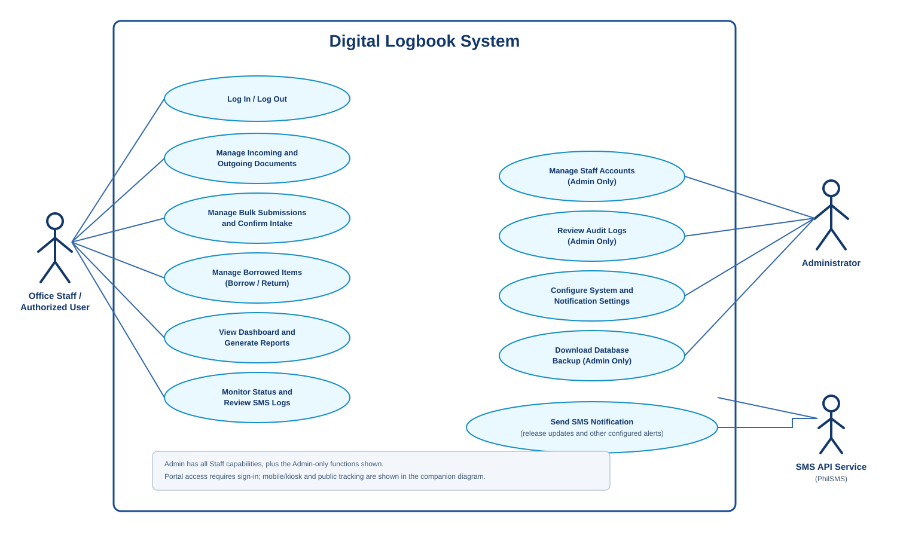
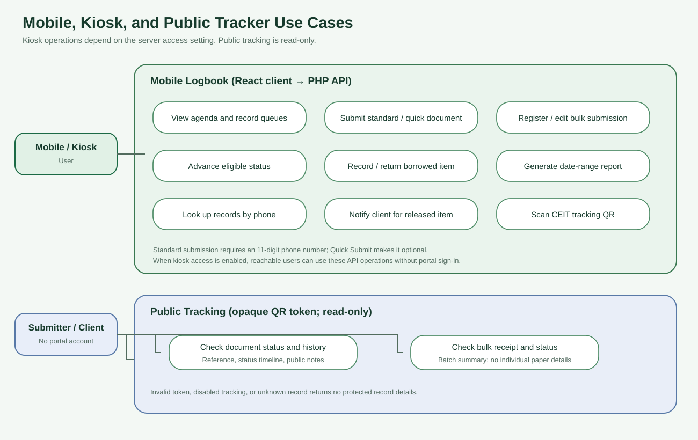
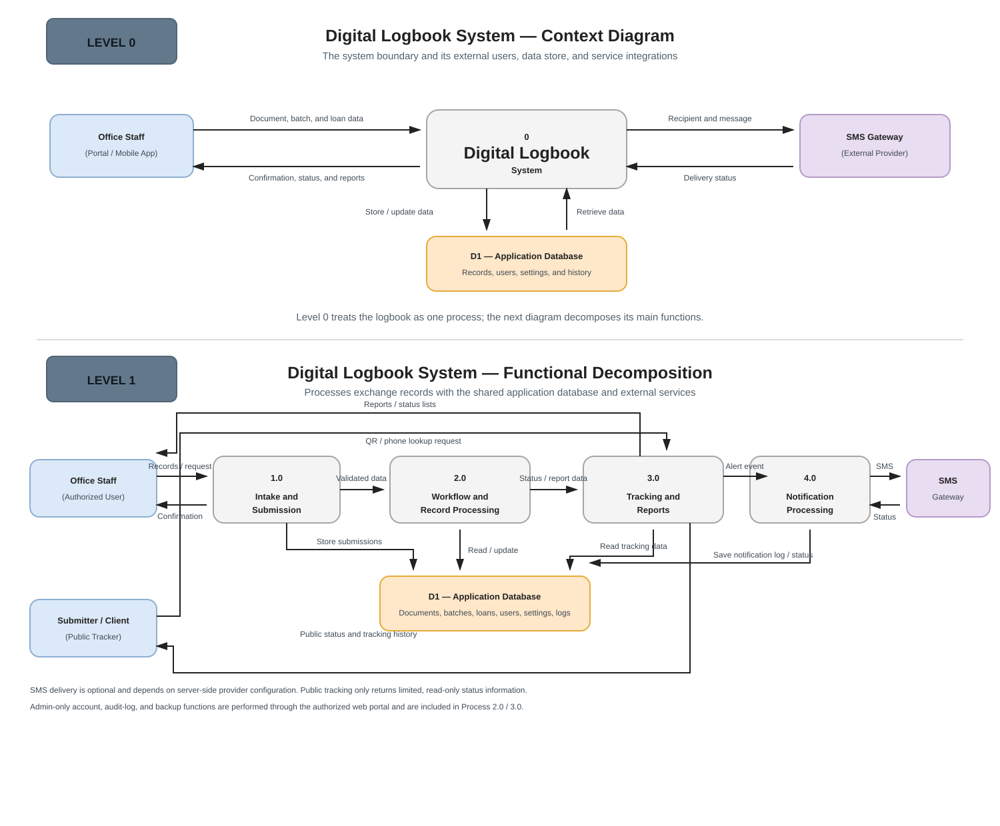
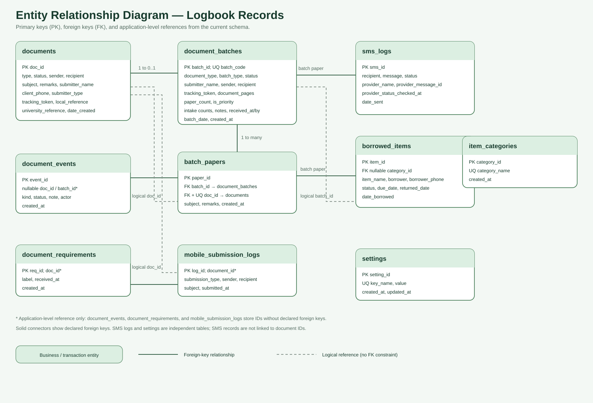
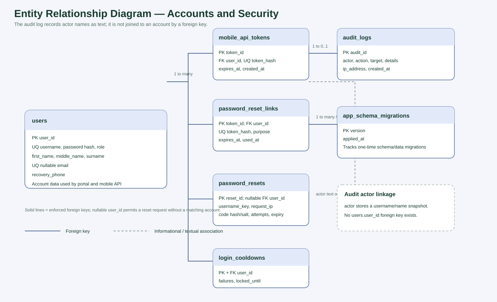
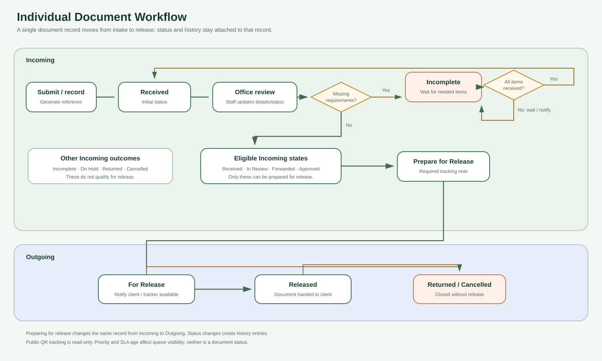
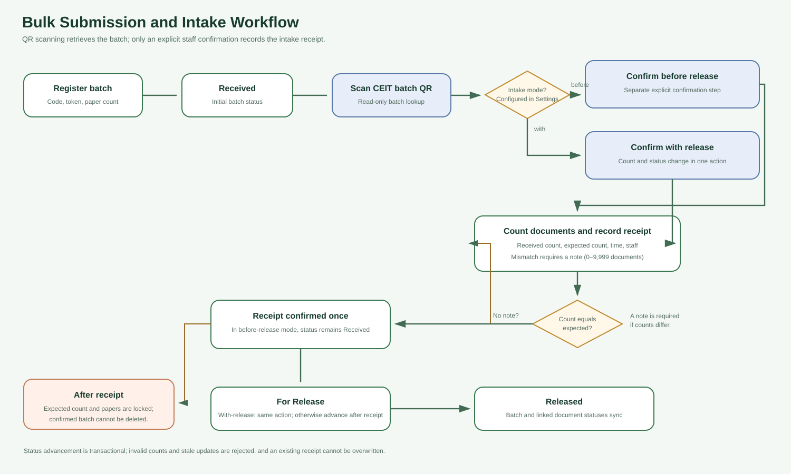

# CEIT Dean's Office Digital Logbook — Capstone Diagrams

This image pack summarizes the system's actors, use cases, architecture,
database relationships, and document workflows. It reflects the current
implementation; confirm office policies and role names before treating it as
an approved institutional specification.

For detailed use-case descriptions and actor notes, see
[Capstone Use-Case Model](./CAPSTONE-USE-CASES.md). For implementation details,
see [System Flow](./SYSTEM-FLOW.md).

## Use cases

### System use cases

The actor-and-oval layout follows a standard system-boundary use-case diagram.
Admin capabilities include all Staff functions; the diagram highlights the
additional Admin-only account, audit-log, and backup functions.

### Mobile and public tracking

Mobile/kiosk operations and the read-only public QR tracking paths.

## Data-flow diagrams

The context diagram is split into **Level 0** (the system as one process) and
**Level 1** (intake, workflow processing, tracking/reports, notifications, and
their shared database). Arrows show the direction of data exchange.

## Database entity-relationship diagrams

The diagrams are split for readability. Lines indicate declared foreign keys;
application-level ID references are shown separately in the diagrams where
they do not have a database foreign-key constraint.

### Records, requirements, batches, and history

### Accounts and supporting data

## Workflows

### Individual document lifecycle

Shows intake, review, incomplete-requirement handling, preparation for release,
and outgoing processing. Preparing for release changes the same record from
Incoming to Outgoing.

### Bulk submission and intake

Shows batch registration, QR lookup, explicit receipt confirmation, count
discrepancy handling, and status synchronization with linked documents. Intake
confirmation may be separate from release or may be performed in the same
action that moves the batch to For Release, depending on the configured mode.

