# CEIT Dean's Office Digital Logbook
## Capstone Use-Case Model

This document describes the use cases implemented by the CEIT Dean's Office
Digital Logbook. It is based on the current PHP portal, React mobile client,
mobile API, and database schema. It is intended as a capstone analysis/design
reference; confirm role names, workflow policies, and operational limits with
the office before submitting it as an approved institutional specification.

## 1. System overview

The system records and tracks incoming and outgoing documents, bulk
submissions, borrowed office items, SMS notifications, and account activity.
Office personnel use the browser-based portal. A React mobile client accesses
the same logbook through the PHP API. A submitter with a valid QR link can view
limited tracking information without signing in.

### System boundary

**Inside the system**

- Admin portal: authentication, accounts, documents, bulk submissions,
  inventory loans, reports, settings, audit history, and database backup.
- Mobile client/API: agenda and record views, submissions, workflow updates,
  borrowing, reporting, and phone-number status lookup.
- Public document and bulk trackers: read-only status and history views.
- Persisted application data: users, records, requirements, batches, loans,
  settings, logs, and history.

**External dependencies**

- MySQL/MariaDB stores application data.
- PhilSMS is an optional external service for SMS delivery and delivery-status
  checks.
- SMTP is an optional external service for account setup and password recovery
  links.
- The office server, browser, and mobile device provide the local network and
  camera capabilities.

The application does not configure PhilSMS credentials or SMTP credentials
through its user-facing settings. Those integrations require server-side
configuration.

## 2. Actors

| Actor | Description |
|---|---|
| **Administrator (Admin)** | Authorized office user with all Staff functions plus account management, audit-log access, and database-backup access. |
| **Staff** | Authorized office user who signs in to process documents, bulk submissions, loans, reports, and operational settings. Staff accounts do not use the Admin-only account-management page. |
| **Mobile/Kiosk User** | Person using the mobile client. When kiosk access is enabled, the current client can use the mobile logbook without signing in; when kiosk access is disabled, API access requires a valid bearer token. The shipped React client does not provide a sign-in screen. |
| **Submitter / Client** | Person who submits documents or checks a tracking link or registered phone number. This person is not an authenticated portal user. |
| **PhilSMS Service** | External SMS provider that accepts outbound messages and may report delivery status. |
| **SMTP Service** | External mail service used for account setup and password-recovery links when configured. |
| **Server Operator** | Person responsible for XAMPP/MySQL, SMTP/SMS credentials, host backups, and command-line maintenance. This is an operational actor, not a portal role. |

### Authorization note

Portal pages require a signed-in Admin or Staff session. Admin-only operations
are explicitly checked by the application. Mobile access is a separate access
path: enabling kiosk mode intentionally permits API operations from users who
can reach the server; token authentication is available at the API, but the
current React client does not expose its login flow. Public QR tracking is
read-only and uses an opaque tracking token.

## 3. Use-case diagram

```mermaid
flowchart LR
    staff[Staff]
    admin[Administrator]
    kiosk[Mobile or Kiosk User]
    client[Submitter or Client]
    sms[PhilSMS Service]
    mail[SMTP Service]
    operator[Server Operator]

    subgraph system["CEIT Dean's Office Digital Logbook"]
        login((Sign in / sign out))
        recover((Recover password))
        account((Manage staff accounts))
        ownaccount((Manage own account))
        incoming((Record and process incoming documents))
        release((Prepare document for release))
        outgoing((Manage outgoing documents))
        batch((Manage bulk submissions))
        intake((Confirm bulk intake and advance status))
        tracking((View QR status and history))
        mobile((Use mobile logbook))
        phone((Look up status by phone))
        loans((Manage borrowed items))
        categories((Manage item categories))
        smsuse((Send and monitor SMS))
        records((Search records and generate reports))
        dashboard((Review dashboard and overdue work))
        settings((Configure system workflow))
        preferences((Set browser workspace preferences))
        audit((Review audit and status history))
        backup((Download database backup))
        maintenance((Run guarded data maintenance))
    end

    admin -. inherits .-> staff
    staff --> login
    staff --> ownaccount
    staff --> incoming
    staff --> release
    staff --> outgoing
    staff --> batch
    staff --> intake
    staff --> loans
    staff --> categories
    staff --> smsuse
    staff --> records
    staff --> dashboard
    staff --> settings
    staff --> preferences
    staff --> mobile

    admin --> account
    admin --> audit
    admin --> backup
    admin --> maintenance

    client --> tracking
    client --> phone
    kiosk --> mobile

    staff --> recover
    admin --> recover
    recover --> mail
    recover --> sms
    smsuse --> sms
    operator --> maintenance
```

In the diagram, Admin inherits the Staff use cases. The Server Operator is
responsible for host-level setup and the optional command-line data console;
that console is not a normal portal page.

## 4. Document and bulk-submission lifecycle

The following status values are used by the current application:

| Record | Statuses / transitions |
|---|---|
| Incoming document | `Received`, `In Review`, `Forwarded`, `Incomplete`, `On Hold`, `Approved`, `Returned`, or `Cancelled`. Eligible `Received`, `In Review`, `Forwarded`, or `Approved` documents can be prepared for release. |
| Outgoing document | `For Release`, `Released`, `Returned`, or `Cancelled`. |
| Bulk submission | Uses the shared workflow statuses. The ordinary progression is from an eligible incoming status to `For Release`, then to `Released`. Advancing a batch synchronizes the status of its linked documents. |

An incoming document is **not** a separate copy when prepared for release.
Its existing record changes to Outgoing, preserving its record ID, reference,
tracking token, and history. The sender and recipient are reversed for the
handoff.

An Incomplete document has one or more outstanding requirement checklist
items. When all items are marked received, its status returns to `Received`.
Bulk intake confirmation is a separate event from QR scanning: a scan retrieves
the batch; an explicit staff confirmation records the counted number of papers.

## 5. Use-case catalogue

| ID | Use case | Primary actor(s) |
|---|---|---|
| UC-01 | Sign in and sign out | Staff, Administrator |
| UC-02 | Recover a forgotten password | Staff, Administrator; SMTP/PhilSMS |
| UC-03 | Manage staff accounts | Administrator |
| UC-04 | Manage own account and credentials | Administrator |
| UC-05 | Record an incoming document | Staff, Administrator |
| UC-06 | Review and process an incoming document | Staff, Administrator |
| UC-07 | Prepare an eligible document for release | Staff, Administrator |
| UC-08 | Manage an outgoing document | Staff, Administrator |
| UC-09 | Register and manage a bulk submission | Staff, Administrator |
| UC-10 | Confirm bulk intake and advance its status | Staff, Administrator |
| UC-11 | Check a document or batch using its QR tracker | Submitter / Client |
| UC-12 | Use the mobile logbook | Mobile/Kiosk User |
| UC-13 | Look up submissions by phone number | Mobile/Kiosk User |
| UC-14 | Manage borrowed items and categories | Staff, Administrator |
| UC-15 | Send and monitor SMS notifications | Staff, Administrator; PhilSMS |
| UC-16 | Search records and generate reports | Staff, Administrator |
| UC-17 | Review dashboard activity and overdue work | Staff, Administrator |
| UC-18 | Configure logbook and workflow settings | Staff, Administrator |
| UC-19 | Set browser workspace preferences | Staff, Administrator |
| UC-20 | Review account and document history | Administrator |
| UC-21 | Download a database backup | Administrator; Server Operator |
| UC-22 | Clear selected operational data | Server Operator |

## 6. Detailed use-case specifications

### UC-01 — Sign in and sign out

| Field | Specification |
|---|---|
| Primary actor | Staff or Administrator |
| Preconditions | The user has an active account; the application and database are available. |
| Trigger | The user opens the login page and submits their username and password. |
| Main success flow | 1. The user enters both credentials. 2. The system verifies the account and password. 3. The system starts a new authenticated session and records a successful login event. 4. The system opens the dashboard. 5. To sign out, the user selects Sign out; the system clears the session and returns to login. |
| Alternate / exception flows | A missing credential or invalid pair is rejected with a generic sign-in error. After five failed attempts, sign-in is locked for 15 minutes. A database or authentication failure prevents access and is reported as temporarily unavailable. |
| Postconditions | On success, the session is associated with the account and its current role. On sign out, the portal session is ended. |

### UC-02 — Recover a forgotten password

| Field | Specification |
|---|---|
| Primary actor | Staff or Administrator |
| Supporting actors | SMTP Service or PhilSMS, depending on account configuration |
| Preconditions | The user can reach the recovery page. The account has a usable registered email or recovery phone, and the matching service is configured. |
| Trigger | The user selects **Forgot your password?** and submits their username. |
| Main success flow | 1. The user requests recovery. 2. The system applies request throttling and issues a time-limited, single-use email link or SMS verification code, when eligible. 3. The user follows the link or submits the code. 4. The user enters and confirms a replacement password of at least eight characters. 5. The system changes the password, invalidates the recovery credential and existing mobile tokens, then directs the user to sign in again. |
| Alternate / exception flows | An invalid, expired, used, or incorrect credential is rejected; SMS verification is limited to five attempts. A request may be rate-limited. Responses do not disclose whether an account exists. If recovery is unavailable, the user contacts an Admin for a reset. |
| Postconditions | The password is updated; prior mobile API tokens are revoked; the user must authenticate again. |

### UC-03 — Manage staff accounts

| Field | Specification |
|---|---|
| Primary actor | Administrator |
| Preconditions | Admin is signed in. |
| Trigger | The Admin opens **Account management**. |
| Main success flow | 1. The Admin enters a staff member's name and optional email and recovery phone. 2. The system validates the values and creates a unique username and temporary password. 3. The system creates a Staff account and displays the credentials once; if email setup is configured, it sends a setup link. 4. The Admin may update the staff email/recovery phone, reset a Staff password, or remove a Staff account. 5. Account actions are written to the account audit log. |
| Alternate / exception flows | Invalid names, duplicate email addresses, or invalid phone numbers are rejected. Email setup can fail without blocking account creation; the temporary password must then be shared securely. Admin accounts cannot be reset or removed through Staff-account actions, and a user cannot delete their own account. |
| Postconditions | The requested account change is stored and security-relevant activity is auditable. |

### UC-04 — Manage own account and credentials

| Field | Specification |
|---|---|
| Primary actor | Administrator |
| Preconditions | User is signed in. |
| Trigger | The user opens account settings or the account-management page. |
| Main success flow | 1. The Admin changes their own password, email, or recovery phone in Account Management. 2. The system validates the new value and confirms password changes with the current password. 3. The system stores the change and records the applicable audit event. |
| Alternate / exception flows | A password shorter than eight characters, mismatched confirmation, invalid email, or invalid phone number is rejected. Password changes invalidate the user's existing mobile API tokens and require a new sign-in. |
| Postconditions | The account reflects the accepted values; sensitive values are not displayed in audit logs. |

### UC-05 — Record an incoming document

| Field | Specification |
|---|---|
| Primary actor | Staff or Administrator |
| Preconditions | User is signed in; the Incoming Documents page is available. |
| Trigger | The user selects **Add Incoming Document** and submits its details. |
| Main success flow | 1. The user provides submitter name and type, document type/title, optional department or office, remarks, and optional phone number. 2. The system validates required fields, lengths, and the optional 11-digit phone number. 3. The system assigns an internal record ID and local reference, saves an Incoming document with `Received` status, and records its initial status history. 4. The new record appears in the incoming queue. |
| Alternate / exception flows | Invalid or incomplete input is rejected and the form remains available for correction. A duplicate generated reference or database failure prevents successful creation and reports an error. |
| Postconditions | One Incoming record is stored with its initial status and generated local reference. |

### UC-06 — Review and process an incoming document

| Field | Specification |
|---|---|
| Primary actor | Staff or Administrator |
| Preconditions | User is signed in; an Incoming record exists. |
| Trigger | The user opens the Incoming Documents queue or a selected record. |
| Main success flow | 1. The system lists Incoming records and permits search, status/submitter filtering, priority ordering, and overdue filtering. 2. The user edits submitter and document details, changes a valid Incoming status, or marks the record Priority. 3. For an Incomplete record, the user records missing requirements and may notify the submitter. 4. The user marks received requirements; when no items remain, the system returns the status to `Received` and may send a completion SMS. 5. Status changes and tracking notes are recorded in history. |
| Alternate / exception flows | Invalid fields or status values are rejected. A record that has already moved out of Incoming cannot be changed through this workflow. A document cannot be prepared for release while Incomplete or On Hold. Missing-requirement SMS is not sent if no valid phone number exists or the SMS service is unavailable. |
| Postconditions | The Incoming record reflects the accepted details, priority, status, requirements, and status history. |

### UC-07 — Prepare an eligible document for release

| Field | Specification |
|---|---|
| Primary actor | Staff or Administrator |
| Preconditions | User is signed in; the selected Incoming document is `Received`, `In Review`, `Forwarded`, or `Approved`. |
| Trigger | The user chooses **Prepare for Release** and supplies tracking details for the status change. |
| Main success flow | 1. The system verifies the record is still Incoming and eligible. 2. The user confirms the release preparation. 3. The system changes the same record to Outgoing with `For Release` status, reverses sender/recipient for the handoff, and records the supplied history note. 4. The document appears in Outgoing Documents. |
| Alternate / exception flows | Invalid tracking details, a missing record, an ineligible status, or a concurrent change prevents the transition. The user refreshes the queue and checks the current state before retrying. |
| Postconditions | The record is Outgoing and `For Release`; its identifier and existing tracking capability remain associated with it. |

### UC-08 — Manage an outgoing document

| Field | Specification |
|---|---|
| Primary actor | Staff or Administrator |
| Preconditions | User is signed in; an Outgoing record exists. |
| Trigger | The user opens Outgoing Documents and selects a record. |
| Main success flow | 1. The system lists outgoing records and supports search, status and overdue filters, and ordering. 2. The user may edit the document title, remarks, or client phone; save or clear a university reference; issue a tracking QR; or change status with a history note. 3. The system validates and saves the selected change. 4. When appropriate, the user sends a generated release notification to the client. |
| Alternate / exception flows | Invalid phone/reference values are rejected. A QR cannot be issued while tracking is disabled. A notification is allowed only for a valid client number and a document still in `For Release`; recent sends are rate-limited to reduce duplicates. |
| Postconditions | The Outgoing record and any issued tracker token reflect the saved change; status changes are in the history. |

### UC-09 — Register and manage a bulk submission

| Field | Specification |
|---|---|
| Primary actor | Staff or Administrator |
| Preconditions | User is signed in; Bulk Documents is available. |
| Trigger | The user chooses to add or edit a bulk submission. |
| Main success flow | 1. The user enters submission type, submitter name/type, date, a count of one to three documents, optional per-document page counts, remarks, and priority. 2. The system validates required values and page counts. 3. For a new batch, the system creates a unique batch code and tracker token. 4. The user can edit batch metadata and review batch status. Where individual paper records are linked to a batch, the user can also edit a paper's title/remarks; those changes are saved to the linked document and batch-paper record together. |
| Alternate / exception flows | Invalid dates, counts, or page data are rejected. A batch's expected paper count cannot change after receipt confirmation. A confirmed batch and its papers cannot be deleted. Deleting a category or batch may be blocked when database relationships prohibit the deletion. |
| Postconditions | The batch and its linked records contain the accepted metadata and maintain their relationships. |

### UC-10 — Confirm bulk intake and advance its status

| Field | Specification |
|---|---|
| Primary actor | Staff or Administrator |
| Preconditions | User is signed in; an eligible, unconfirmed Incoming batch exists. |
| Trigger | Staff scan a CEIT batch QR and explicitly confirm receipt, or advance the batch using the configured intake mode. |
| Main success flow | 1. The system scans/looks up the QR and shows batch details; scanning alone does not confirm receipt. 2. Staff counts the received documents and enters a note if the count differs from the expected count. 3. The system records received count, expected count, confirmation time, confirming user, and note exactly once. 4. Staff advances the batch from an eligible Incoming status to `For Release`, and later to `Released`. 5. Each transition updates the batch and linked document statuses together and adds history. |
| Alternate / exception flows | The configured workflow may require receipt confirmation before status advancement or combine confirmation with the move to `For Release`. Invalid counts, a missing mismatch note, a repeated confirmation, a stale status, or an already released batch is rejected or treated as already confirmed. |
| Postconditions | The receipt is immutable, its audit/history is retained, and batch and linked document statuses remain synchronized. |

### UC-11 — Check a document or batch using its QR tracker

| Field | Specification |
|---|---|
| Primary actor | Submitter / Client |
| Preconditions | The office issued a QR link and tracking is enabled; the user has the link. |
| Trigger | The user scans the QR or opens the tracker URL. |
| Main success flow | 1. The system validates the opaque token. 2. The system returns only the selected document's or batch's public tracking fields and history. 3. The user reviews current status, reference, and any public notes or receipt details. 4. The page can refresh to show newer status. |
| Alternate / exception flows | Invalid, missing, or unknown tokens show no record details. Disabled tracking or unavailable storage prevents a successful lookup. |
| Postconditions | No data is changed; internal account details and staff identities are not disclosed on the public timeline. |

### UC-12 — Use the mobile logbook

| Field | Specification |
|---|---|
| Primary actor | Mobile/Kiosk User |
| Preconditions | The device can reach the office server. Kiosk access is enabled, or the API request supplies a valid bearer token. |
| Trigger | The user opens the mobile application. |
| Main success flow | 1. The client loads the current day's logbook data, form labels, and mobile display settings. 2. The user views Incoming, Outgoing, Bulk Documents, Borrowed Items, or Reports, and may scan a CEIT tracking QR with the camera or an image. 3. The user can refresh the data manually or wait for periodic refresh while online. 4. The user submits a standard document (11-digit contact number required) or quick document (contact optional); the system returns a reference and, when tracking is enabled, a tracker link/QR. 5. Depending on the selected section and available record, the user adds or edits a batch, advances an allowed document/batch status, records a loan or return, sends an eligible released-document notification, or requests a report. |
| Alternate / exception flows | If the device is offline, data refresh or writes fail and the client reports the problem; reconnecting permits another refresh. When kiosk access is disabled, unauthenticated API requests are denied. The bundled React client has no sign-in screen, so a valid token must be supplied by another supported client if kiosk access is disabled. |
| Postconditions | Successful mobile actions are stored in the same logbook as portal actions. |

### UC-13 — Look up submissions by phone number

| Field | Specification |
|---|---|
| Primary actor | Mobile/Kiosk User |
| Preconditions | The mobile client can reach the API. |
| Trigger | The user selects client status lookup and enters a phone number. |
| Main success flow | 1. The user enters an 11-digit number. 2. The system normalizes digits and searches matching document contact numbers and batches explicitly addressed to a contact. 3. The client displays matching records and their statuses. |
| Alternate / exception flows | An invalid number or empty result is reported to the user. Records without a matching stored contact are not returned. |
| Postconditions | The lookup is read-only and changes no record. |

### UC-14 — Manage borrowed items and categories

| Field | Specification |
|---|---|
| Primary actor | Staff or Administrator |
| Preconditions | User is signed in. |
| Trigger | The user opens Borrowed Items or Item Categories. |
| Main success flow | 1. The user records an item, borrower, optional category, and optional phone number. 2. The system saves the loan with `Borrowed` status and a recorded date/time. 3. Staff may search or filter loan records, edit an unreturned loan, mark an item Returned, or reopen a return as unreturned. 4. Staff may add or remove a category when database relationships permit. |
| Alternate / exception flows | Item name and borrower are required; invalid contact data is rejected. Returned loans cannot be edited until reopened. A category referenced by a loan cannot be removed while its foreign-key relationship exists. |
| Postconditions | The loan reflects the recorded borrower and current return state; the return date is set or cleared as appropriate. |

### UC-15 — Send and monitor SMS notifications

| Field | Specification |
|---|---|
| Primary actor | Staff or Administrator |
| Supporting actor | PhilSMS Service |
| Preconditions | User is signed in. SMS may be disabled or unavailable if server credentials are not configured. |
| Trigger | The user sends a document notification or a manual SMS, opens SMS Logs, refreshes delivery statuses, or retries a failed message. |
| Main success flow | 1. The user selects an eligible document notification or enters a valid recipient and manual message. 2. The system submits the SMS to PhilSMS and records provider, status, and message ID where available. 3. The user reviews SMS logs and can request delivery-status refresh. 4. A message marked Failed may be resent; the existing log row is updated for that attempt. |
| Alternate / exception flows | Invalid recipients, disabled SMS configuration, provider rejection, or network failure are reported and logged. Provider acceptance without delivery confirmation remains Pending rather than being represented as Delivered. Only failed eligible messages can be retried; duplicate/recent document notifications are blocked. |
| Postconditions | The message attempt and latest known provider status are recorded in SMS Logs. |

### UC-16 — Search records and generate reports

| Field | Specification |
|---|---|
| Primary actor | Staff or Administrator |
| Preconditions | User is signed in; records are available. |
| Trigger | The user searches Document Records or opens Reports. |
| Main success flow | 1. The user searches document records by available fields or selects a report type and date range. 2. The system validates the report type and inclusive date range. 3. The system displays matching Incoming, Outgoing, Bulk, Borrowed Items, SMS, or combined report data with applicable summaries and filters. 4. The user prints or exports the report using the available output controls. |
| Alternate / exception flows | Invalid dates or unsupported report types are rejected. A valid range with no data displays an empty-result message. A database or export failure is reported without claiming that the report was generated. |
| Postconditions | Search and report operations do not alter source records. |

### UC-17 — Review dashboard activity and overdue work

| Field | Specification |
|---|---|
| Primary actor | Staff or Administrator |
| Preconditions | User is signed in; dashboard data is available. |
| Trigger | The user opens the dashboard or selects an activity/overdue summary. |
| Main success flow | 1. The system summarizes current and recent document activity, open queues, borrowing, SMS, and workload analytics. 2. It applies the configured SLA limits to open Incoming and `For Release` Outgoing documents and bulk submissions. 3. The user opens an overdue list and follows a record link to review the item. |
| Alternate / exception flows | If SLA reporting is disabled, overdue indicators are hidden. Missing or invalid settings use validated defaults. Empty queues display no overdue records. |
| Postconditions | Dashboard review is read-only; any subsequent work occurs in the relevant record workflow. |

### UC-18 — Configure logbook and workflow settings

| Field | Specification |
|---|---|
| Primary actor | Staff or Administrator |
| Preconditions | User is signed in; settings storage is available. |
| Trigger | The user opens Admin Settings and submits a settings form. |
| Main success flow | 1. The user configures mobile kiosk access, document tracking and tracker base URL, SLA limits, print/report options, batch intake-confirmation mode, mobile form labels, or mobile appearance. 2. The system validates enumerated values, URL, label lengths, and day limits. 3. The system stores valid settings for use by the portal, API, tracker, or mobile client. |
| Alternate / exception flows | Invalid values are rejected and are not saved. SMS provider credentials and SMTP credentials are not maintained here; the Server Operator configures those outside the portal. |
| Postconditions | Accepted settings are persisted and affect their corresponding application flows. |

### UC-19 — Set browser workspace preferences

| Field | Specification |
|---|---|
| Primary actor | Staff or Administrator |
| Preconditions | User can access the portal in a browser. |
| Trigger | The user opens workspace settings or changes a workspace control. |
| Main success flow | 1. The user selects browser-specific activity polling, alerts/sounds, submission notices, Compact Mode, or other available local workspace preferences. 2. The browser stores those preferences locally and applies them to that browser's portal experience. |
| Alternate / exception flows | Preferences saved in one browser/device do not automatically synchronize to another. Browser storage or notification permission may be unavailable; the user can continue using the portal without those optional preferences. |
| Postconditions | The current browser applies its saved preferences without changing server-wide workflow settings. |

### UC-20 — Review account and document history

| Field | Specification |
|---|---|
| Primary actor | Administrator |
| Preconditions | Admin is signed in. |
| Trigger | The Admin opens System Audit Logs. |
| Main success flow | 1. The system displays recent account/security events and document/bulk status history. 2. The Admin reviews actor, event, date, affected record, and permitted details. |
| Alternate / exception flows | Staff are denied access. If either history source cannot be loaded, the page reports that failure rather than presenting it as an empty successful result. |
| Postconditions | History review is read-only. Sensitive credentials and contact values are not exposed as audit details. |

### UC-21 — Download a database backup

| Field | Specification |
|---|---|
| Primary actor | Administrator |
| Supporting actor | Server Operator |
| Preconditions | Admin is signed in; the server has `mysqldump`, `proc_open`, database access, and InnoDB tables. |
| Trigger | The Admin selects the backup action in Admin Settings. |
| Main success flow | 1. The system verifies the request and database storage engines. 2. It creates a consistent SQL dump containing database structures, records, and database routines/events/triggers. 3. The system streams the dump to the Admin as a file download and removes temporary resources. 4. The Admin stores the backup securely outside the web root. |
| Alternate / exception flows | Non-POST access is rejected. Missing tools, unsupported table engines, insufficient privileges, or dump failures stop the download and report an error. |
| Postconditions | On success, the Admin receives a database backup; this use case does not copy application files, credentials, or certificates. |

### UC-22 — Clear selected operational data

| Field | Specification |
|---|---|
| Primary actor | Server Operator |
| Preconditions | Operator has authorized command-line access to the project and has reviewed the target and current backup. |
| Trigger | Operator invokes the mobile submission console's clear/purge command for a supported data scope. |
| Main success flow | 1. The console displays available record counts and supported scopes. 2. The operator selects one scope and confirms the destructive operation using its required confirmation. 3. The console clears only the selected supported records and reports the result. |
| Alternate / exception flows | Invalid scopes, missing confirmation, failed database operations, or dependency constraints prevent the operation. The operator must stop and investigate rather than repeat a destructive command blindly. |
| Postconditions | Selected records are cleared; retained scopes remain untouched. |

## 7. Business rules and validation summary

1. Portal changes require an authenticated session and CSRF validation.
2. Admin-only actions include Staff account management, audit-log access, and
   database backup. Admin inherits ordinary Staff workflows.
3. Incoming document submitter name, submitter type, and document title are
   required. Optional phone numbers use the system's 11-digit format.
4. Only eligible Incoming statuses can be prepared for release. The move
   preserves the document record and records a history event with a required
   tracking note.
5. Incomplete documents maintain a requirements checklist. They return to
   `Received` when all requirements are marked received.
6. Bulk receipt confirmation records expected/received counts, time, confirming
   staff member, and any discrepancy note. Confirmation cannot be overwritten;
   expected count cannot be changed afterward.
7. Batch status advancement updates linked documents in the same workflow.
8. A QR scan is a lookup, not a receipt confirmation. Public QR views are
   read-only and expose only a limited record view.
9. SMS delivery is asynchronous/externally dependent. Provider acceptance is
   not treated as proof of delivery.
10. Mobile kiosk mode is a separate access setting; when enabled, users with
    network access can use the current mobile API without portal sign-in.
11. Reports are read-only and validate both report type and date range.
12. Destructive maintenance is an operator-level action and must be confirmed.

## 8. Functional requirements traceability

| Requirement | Implemented use cases | Main implementation surfaces |
|---|---|---|
| Authentication, role authorization, and password recovery | UC-01–UC-04 | [`pages/login.php`](../pages/login.php), [`pages/forgot_password.php`](../pages/forgot_password.php), [`pages/users.php`](../pages/users.php), [`includes/auth.php`](../includes/auth.php) |
| Incoming document intake and workflow | UC-05–UC-07 | [`pages/incoming.php`](../pages/incoming.php), [`includes/status_support.php`](../includes/status_support.php), [`includes/requirements_support.php`](../includes/requirements_support.php) |
| Outgoing handoff, notification, and tracking QR | UC-07, UC-08, UC-11, UC-15 | [`pages/outgoing.php`](../pages/outgoing.php), [`includes/document_tracking.php`](../includes/document_tracking.php), [`includes/message_composer.php`](../includes/message_composer.php) |
| Bulk submission and intake reconciliation | UC-09–UC-11 | [`pages/batch_papers.php`](../pages/batch_papers.php), [`pages/batch_tracker.php`](../pages/batch_tracker.php), [`includes/batch_support.php`](../includes/batch_support.php) |
| Mobile access and client status lookup | UC-12–UC-13 | [`mobile-ui/src/App.jsx`](../mobile-ui/src/App.jsx), [`api/mobile-api.php`](../api/mobile-api.php) |
| Borrowed inventory | UC-14 | [`pages/borrowed.php`](../pages/borrowed.php), [`pages/item_categories.php`](../pages/item_categories.php) |
| SMS communications | UC-02, UC-06, UC-08, UC-15 | [`pages/sms.php`](../pages/sms.php), [`includes/sms_service.php`](../includes/sms_service.php), [`includes/password_reset_support.php`](../includes/password_reset_support.php) |
| Search, reports, and dashboard | UC-16–UC-17 | [`pages/records.php`](../pages/records.php), [`pages/reports.php`](../pages/reports.php), [`pages/dashboard.php`](../pages/dashboard.php) |
| Settings, workspace preferences, audit trail, backup, maintenance | UC-18–UC-22 | [`pages/settings.php`](../pages/settings.php), [`pages/notification_settings.php`](../pages/notification_settings.php), [`pages/audit_logs.php`](../pages/audit_logs.php), [`api/backup_download.php`](../api/backup_download.php), [`tools/mobile_submission_console.php`](../tools/mobile_submission_console.php) |

## 9. Scope notes for capstone presentation

- The mobile client is currently a shared, kiosk-style client rather than a
  user-specific authenticated client. Present this accurately; do not describe
  it as role-based mobile sign-in.
- SMS, email, office-network access, camera scanning, backup, and restoration
  depend on server configuration and device/network capability.
- The database stores operational records and user accounts. The user-facing
  workflows above are the use cases; schema tables alone do not imply extra
  user actions such as attaching files or deleting individual documents.
- This catalogue describes implemented behavior, not a guarantee of
  institutional policy. Confirm proposed requirements and final statuses with
  the CEIT Dean's Office before defense or deployment.
